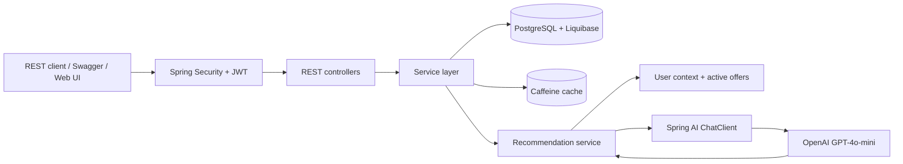

# BartExchangeAI

[](https://openjdk.org/)
[](https://spring.io/projects/spring-boot)
[](https://github.com/rusliksu/bart-exchange-ai/actions/workflows/ci.yml)

AI-assisted barter exchange backend built with Spring Boot. The project combines a JWT-secured REST API, a relational exchange domain, and an LLM-backed recommendation flow that can run in a mock mode during development.

> No hosted demo is advertised: run the stack locally and inspect the API through Swagger UI.

## What this project demonstrates

| Area | Implementation |
| --- | --- |
| Backend API | Spring MVC controllers for users, offers, categories, groups, exchanges, messages, reviews, authentication, and recommendations |
| AI integration | Spring AI `ChatClient` ranks active offers using the user's offers, exchange history, ratings, and candidate-owner ratings |
| Persistence | PostgreSQL with Liquibase migrations in production; H2 with Hibernate DDL in the development profile |
| Security | Stateless Spring Security with JWT authentication, BCrypt password hashing, method security, and public catalog reads |
| Performance | Caffeine cache for recommendation results with a 10-minute expiry and bounded candidate/result lists |
| Delivery | Docker Compose, GitHub Actions build/test pipeline, JAR artifact, GHCR image, and OWASP dependency analysis |

## Architecture



The recommendation endpoint is `GET /api/recommendations/user/{userId}`. In production mode it gathers bounded domain context, asks the model for structured `RecommendationDto` results, limits the response to five items, and caches the result by user. In development mode the same interface is backed by a mock implementation, so the application starts without an API key.

## Quick start: development mode

Requirements: Java 21 and either Gradle 8+ or the included Gradle wrapper.

```bash
git clone https://github.com/rusliksu/bart-exchange-ai.git
cd bart-exchange-ai
./gradlew bootRun
```

On Windows:

```powershell
.\gradlew.bat bootRun
```

The default `dev` profile uses an in-memory H2 database, creates the schema with Hibernate, and enables mock recommendations. No OpenAI key or PostgreSQL instance is required.

Useful local surfaces:

- Application: <http://localhost:8080>
- Swagger UI: <http://localhost:8080/swagger-ui.html>
- Health: <http://localhost:8080/actuator/health>
- Public active offers: `GET /api/offers/active`

To try authenticated endpoints, register and log in through `POST /api/auth/register` and `POST /api/auth/login`, then use the returned JWT as a Bearer token in Swagger UI.

## PostgreSQL and real AI mode

Copy `.env.example` to `.env`, set a real database password, a production JWT secret, and `OPENAI_API_KEY`, then start the complete stack:

```bash
docker compose up --build
```

The Compose profile runs PostgreSQL 16 and the application with the `prod` profile. Production startup validates the Liquibase schema and enables the OpenAI-backed recommendation implementation.

## Recommendation flow

1. Load the user's offers, exchange history, and average review rating.
2. Select up to 50 active offers from other users and collect their average ratings.
3. Build a structured prompt with the user context and candidate offers.
4. Ask Spring AI for a JSON array of `offerId`, title, category, score, and reason.
5. Keep the top five results and cache them for ten minutes.

Configuration is intentionally bounded:

| Property | Default | Purpose |
| --- | ---: | --- |
| `app.recommendation.mock-enabled` | `true` in dev / `false` in prod | Select mock or OpenAI implementation |
| `app.recommendation.max-results` | `5` | Maximum returned recommendations |
| `app.recommendation.max-candidates` | `50` | Maximum offers sent for ranking |
| `spring.cache.caffeine.spec` | `maximumSize=100,expireAfterWrite=10m` | Recommendation cache policy |
| `OPENAI_API_KEY` | empty in dev / required for real AI | Credentials for the OpenAI-backed implementation |

## API surface

| Resource | Base path | Examples |
| --- | --- | --- |
| Authentication | `/api/auth` | Register, login |
| Offers | `/api/offers` | Browse, search, create, update, delete |
| Categories and groups | `/api/categories`, `/api/groups` | Catalog and membership operations |
| Exchanges | `/api/exchanges` | Create, complete, cancel |
| Messages and reviews | `/api/messages`, `/api/reviews` | Exchange communication and ratings |
| Users | `/api/users` | Profiles, ratings, and administration |
| Recommendations | `/api/recommendations` | AI-ranked offers for a user |

GET requests for the public catalog are available without authentication. Mutating operations and private domain operations require a JWT.

## Quality gates

```bash
./gradlew test
./gradlew build
./gradlew dependencyCheckAnalyze
```

The repository currently contains 19 test classes and more than 140 JUnit test methods covering services, controllers, security, and the recommendation integration path. GitHub Actions runs the build and tests on Java 21, publishes the test report and JAR artifact, builds the main-branch Docker image, and runs OWASP Dependency Check.

## Project layout

```text
src/main/java/com/example/bartexchangeai/
├── config/          # Security, OpenAPI, caching, and recommendation wiring
├── controller/      # REST and web controllers
├── dto/             # API payloads, including RecommendationDto
├── model/           # User, offer, exchange, message, review, category, and group
├── repository/      # Spring Data JPA repositories
├── security/        # JWT provider, filter, and user details service
└── service/         # Domain services and AI/mock recommendation implementations
```

The README is intentionally aligned with the running profiles and the current source tree; it does not claim a hosted environment, benchmark numbers, or features that are not present in the repository.
